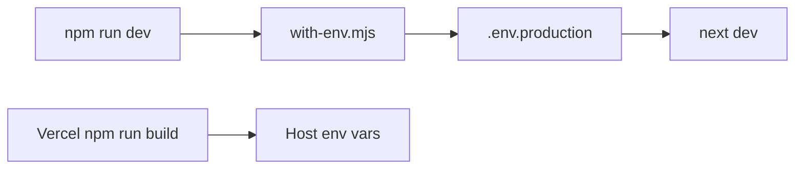

# Production-only cleanup

Audit covered `src/`, `scripts/`, `public/`, `content/`, `supabase/`, root config, and env files (keys only; no secret values). Almost every module is a Next.js entry or is imported. No `package.json` dependency is unused, so the lockfile stays as-is.

## 1. Safe to remove

- Debug statement in [`src/app/admin/orders/new/page.js`](src/app/admin/orders/new/page.js) line 18: `console.log("products")`. It logs on every render and does not print product data.
- Unused homepage UI, only referenced by commented lines in [`src/app/page.js`](src/app/page.js) (lines 7–8, 36, 39):
  - [`src/components/home/trust-dashboard.js`](src/components/home/trust-dashboard.js)
  - [`src/components/home/whatsapp-section.js`](src/components/home/whatsapp-section.js)
  - Remove those commented imports and JSX from `page.js`. GSAP stays; [`src/components/category/category-page-client.js`](src/components/category/category-page-client.js) still imports it.
- Unused export `noindexMetadata` in [`src/lib/seo.js`](src/lib/seo.js) (lines 79–84). Login and checkout already set `robots` inline. Delete the function only.

## 2. Staging-related items to remove

There is no staging app, branch config, or `vercel.json`. Staging is the default env file and script target. In this checkout, `.env.staging` and `.env.production` use the same Supabase host. `.env.production` also has the WhatsApp OTP keys. `.env`, `.env.local`, and `.env.example` do not exist.

- Delete local [`.env.staging`](.env.staging) (gitignored). Leave [`.env.production`](.env.production) unchanged, including `APP_ENV` and `NEXT_PUBLIC_RAZORPAY_KEY_ID` (the Razorpay public key is unused in `src/`; checkout uses `RAZORPAY_KEY_ID` from the create-order API).
- [`package.json`](package.json) scripts:
  - `dev`, `seed`, `migrate:images`, `preview:emails` currently pass `staging` to `with-env.mjs`. Point them at `production`.
  - Remove `dev:prod`, `build:staging`, `seed:prod`, `migrate:images:prod` (duplicates once the defaults are production).
  - Keep `build` as plain `next build` (what Vercel runs) and `build:prod` as the explicit local production build. Keep `start` and `lint`.
- [`scripts/lib/catalog-storage.mjs`](scripts/lib/catalog-storage.mjs): `FALLBACK_ENV_FILES` is `[".env.staging"]`; `loadNamedEnv` accepts `staging`. Fallback and the allowed name become `production` only.
- [`scripts/with-env.mjs`](scripts/with-env.mjs), [`scripts/seed-supabase.mjs`](scripts/seed-supabase.mjs), [`scripts/migrate-images-to-storage.mjs`](scripts/migrate-images-to-storage.mjs): comments and error strings that name `.env.staging`.
- [`src/app/api/auth/send-otp/route.js`](src/app/api/auth/send-otp/route.js) lines 77–88: if WhatsApp is not configured and `APP_ENV !== "production"`, the route logs the full OTP. Production already returns 503. Collapse the missing-WhatsApp path to that 503 so there is no staging/dev mock and no OTP in logs. Comment in [`src/lib/whatsapp-otp.js`](src/lib/whatsapp-otp.js) updated to match.
- [`README.md`](README.md): replace the two-environment setup (staging file, Preview/staging branch, `dev:prod`, `build:staging`, seed staging) with a single `.env.production` workflow. While rewriting those sections, point stock/email migration notes at the files that exist: [`supabase/migrations/20260806_phone_orders.sql`](supabase/migrations/20260806_phone_orders.sql) and [`supabase/migrations/20260817_decrement_stock_lockdown.sql`](supabase/migrations/20260817_decrement_stock_lockdown.sql). README currently names SQL files that are not in the repo.

`APP_ENV` remains in `.env.production` and in the startup line in [`scripts/run-next-dev.mjs`](scripts/run-next-dev.mjs). It will no longer change OTP behavior.

Vercel Preview/staging variables live in the dashboard, not in this repo. After the code change, remove those in the Vercel project settings if they still exist.

## 3. Potentially unused — do not remove

- `NEXT_PUBLIC_RAZORPAY_KEY_ID` in the env files. Unused in source; leave the production file untouched.
- [`middleware.js`](middleware.js) duplicates JWT verification from [`src/lib/auth/session.js`](src/lib/auth/session.js) because Edge middleware cannot import the `server-only` session module. Both stay.
- [`scripts/preview-order-emails.mjs`](scripts/preview-order-emails.mjs) imports `jiti`, which is only a transitive dependency. The script is a maintainer tool, not staging. Keep it; do not add or remove packages for it in this pass.
- [`scripts/catalog-images/`](scripts/catalog-images/) are seed/migrate sources, not public assets. All seven files under `public/images/` are referenced.
- [`content/blog/`](content/blog/) is loaded by [`src/data/blog.js`](src/data/blog.js).
- [`.cursor/plans/order_emails_9a14a8b8.plan.md`](.cursor/plans/order_emails_9a14a8b8.plan.md) is local editor history, not shipped.
- Operational `console.error` / `console.warn` in API routes, stock decrement, and email sending. CLI `console.log` in seed, migrate, and the dev startup banner. These are not debug leftovers.
- `NODE_ENV === "development"` in [`next.config.mjs`](next.config.mjs) (CSP `unsafe-eval`) and `NODE_ENV === "production"` for the secure session cookie. That is Next’s dev-vs-production split, not a staging environment.

## 4. Must retain

- All `src/app` pages, layouts, loading files, and the 18 API routes. Import scan found no other unreferenced `src` modules.
- Dependencies in [`package.json`](package.json): Supabase, Razorpay, Resend, jose, Next, React, framer-motion, gsap, animejs, gray-matter, react-markdown, recharts, lucide-react, Vercel analytics, server-only, Tailwind, ESLint, React compiler. No uninstall.
- Production integrations: Supabase (`NEXT_PUBLIC_SUPABASE_*`, `SUPABASE_SERVICE_ROLE_KEY`), Razorpay, WhatsApp OTP, Resend, `AUTH_SECRET`, `SITE_URL`.
- [`supabase/schema.sql`](supabase/schema.sql), both migrations, [`.github/workflows/keep-supabase-awake.yml`](.github/workflows/keep-supabase-awake.yml) (already pings the production project), seed and image-migration scripts (retargeted to production).

## 5. Risks

- After this change, `npm run dev` loads `.env.production`. Login OTP will send real WhatsApp messages. Missing WhatsApp config returns 503 instead of printing the code.
- `npm run seed` and `npm run migrate:images` will write to the production database. They already would if `.env.staging` points at that same host; the script names will make that explicit.
- Do not edit values inside `.env.production`. Do not refactor auth, checkout, orders, or admin flows.
- Hosted deploy still uses `npm run build` plus Vercel env vars. Local file changes do not update the Vercel dashboard.

## Verification after the edits

- Search the repo (excluding `node_modules` and `.next`) for `staging` and confirm the only remaining hits, if any, are historical comments that were updated.
- `npm run build` with `.env.production` present (Next loads it for production builds).
- `npm run lint`.
- Confirm admin new-order page, homepage, and send-otp route still import cleanly. No browser pass is required for deleted unused components; the production build is the check.
